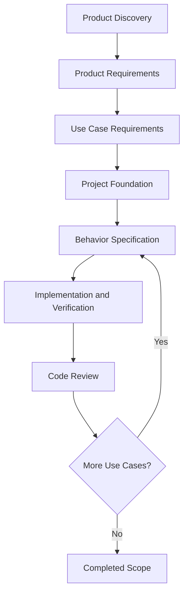
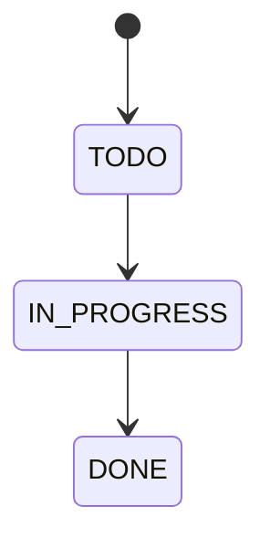

# Agent Skills

[](https://github.com/zhijunio/skills/actions/workflows/ci.yml)
[](LICENSE)

A collection of reusable agent skills for software engineering, specification-driven development, and Spring Boot applications.

Designed for AI coding assistants such as Codex, Claude Code, and Gemini CLI, these skills provide focused workflows, engineering conventions, reference materials, and implementation guidance for building maintainable software.

## Features

- **Specification-driven development** — turn product ideas into explicit requirements, behavior specifications, and verified implementations.
- **Engineering workflows** — support product discovery, domain modeling, project initialization, prototyping, debugging, and code review.
- **Spring Boot development** — focused skills for application architecture, persistence, security, testing, integration, and deployment.
- **Modular skill design** — load only the skills relevant to the current task instead of introducing unnecessary context.
- **Reusable engineering prompts** — automate common documentation, onboarding, and code review tasks.

## Skill Collections

The repository contains 59 skills organized into three collections.

| Collection | Skills | Description |
| --- | ---: | --- |
| [Engineering](engineering/) | 13 | Product discovery, requirements, specifications, implementation, and engineering practices |
| [Spring Boot](spring-boot-skills/) | 39 | Spring Boot 4 application development and delivery |
| [Collected Skills](collected-skills/) | 7 | Useful skills collected from other projects |

## Quick Start

Install skills using the Skills CLI:

```bash
npx skills add https://github.com/zhijunio/skills
```

Or select an individual skill:

```bash
npx skills add https://github.com/zhijunio/skills --skill create-spec
```

Alternatively, copy the desired skill directory into the skills location supported by your coding assistant.

### Skill dependencies

Some skills compose other skills. Installing only an entry point does not guarantee that its sibling skills are installed. Use a common skill root and preserve directory names. In particular:

- `spring-boot` routes to focused Spring Boot skills; install the entire collection when using the router, or select the relevant focused skills and their dependencies.
- `grill-with-docs` requires `grilling` and `domain-modeling`.
- If a required skill is missing, install the dependency or follow the documented fallback; do not assume that a missing skill was loaded.

For an approved local checkout, the following commands illustrate collection and composed-skill installation from a target project:

```bash
npx skills@1.9.1 add /path/to/skills/spring-boot-skills --skill '*'
npx skills@1.9.1 add /path/to/skills --skill grill-with-docs --skill grilling --skill domain-modeling
```

See [distribution verification](docs/verification/distribution.md) for the tested scope and outstanding limitations, and [skill provenance](docs/skill-provenance.md) before redistributing third-party content.

Each skill contains a `SKILL.md` entry point that describes its purpose, workflow, constraints, and supporting resources where applicable.

## Engineering Skills

The [engineering](engineering/) collection supports software development from initial product exploration through implementation and verification.

### Product Discovery

| Skill | Purpose |
| --- | --- |
| [product-brainstorming](engineering/product-brainstorming/SKILL.md) | Explore and refine product ideas |
| [grilling](engineering/grilling/SKILL.md) | Challenge assumptions through focused questioning |
| [grill-with-docs](engineering/grill-with-docs/SKILL.md) | Clarify decisions against existing documentation |
| [domain-modeling](engineering/domain-modeling/SKILL.md) | Establish domain concepts and relationships |
| [prototype](engineering/prototype/SKILL.md) | Explore ideas through prototypes |

### Specification and Implementation

| Skill | Purpose |
| --- | --- |
| [prd-to-requirements](engineering/prd-to-requirements/SKILL.md) | Transform product requirements into structured use cases |
| [project-foundation](engineering/project-foundation/SKILL.md) | Select a technical foundation and verify a runnable project skeleton |
| [create-spec](engineering/create-spec/SKILL.md) | Define feature behavior, business rules, and acceptance criteria |
| [impl-spec](engineering/impl-spec/SKILL.md) | Implement and verify an approved use case |
| [html-plan](engineering/html-plan/SKILL.md) | Present plans in HTML |
| [progen](engineering/progen/SKILL.md) | Support project generation |

### Quality and Maintenance

| Skill | Purpose |
| --- | --- |
| [diagnosing-bugs](engineering/diagnosing-bugs/SKILL.md) | Investigate and diagnose software defects |
| [java-code-review](engineering/java-code-review/SKILL.md) | Review Java code |

## Specification-Driven Development

For a new product, the following workflow illustrates how engineering skills can be combined.



The workflow separates product decisions, technical decisions, expected behavior, and implementation.

| Stage | Skill | Expected Result |
| --- | --- | --- |
| Discovery | `product-brainstorming` | Refined product intent |
| Requirements | `prd-to-requirements` | Structured use cases |
| Foundation | `project-foundation` | Technical baseline and runnable skeleton |
| Specification | `create-spec` | Behavior specification and acceptance criteria |
| Implementation | `impl-spec` | Implemented and verified use case |
| Review | `java-code-review` | Java code review findings |

### Project Documentation

The specification and implementation skills use a documentation structure such as:

```text
docs/
├── requirements.md
├── tech-stack.md
└── specs/
    ├── 001-initial-project-setup.md
    ├── 002-example-feature.md
    └── ...
```

- `requirements.md` — use-case index and implementation status.
- `tech-stack.md` — selected technologies and versions.
- `specs/` — individual behavior specifications.

Each use case has a stable identifier, dependencies, acceptance criteria, and an implementation status.



A use case is marked `DONE` only after its acceptance criteria have been implemented and relevant verification has passed.

## Spring Boot Skills

The [Spring Boot collection](spring-boot-skills/) provides focused guidance for Spring Boot 4 applications.

Use the [spring-boot](spring-boot-skills/spring-boot/SKILL.md) entry skill for tasks that cross multiple technical areas. For focused tasks, invoke the corresponding skill directly.

### Application Architecture

- Project scaffolding
- Feature-based architecture
- Layered architecture
- Hexagonal architecture
- Multi-module Maven
- Spring Modulith
- API versioning

### Web APIs and Integration

- Spring MVC
- OpenAPI
- HTTP interface clients
- React and Next.js integration
- Email delivery
- BootUI developer diagnostics

### Data, Security, and Reliability

- Spring Security
- PostgreSQL
- Spring Data JPA
- MyBatis-Plus
- Spring Data Redis
- Flyway migrations
- Multi-tenancy
- Idempotency
- Resilience and retry
- Event-driven messaging

### AI and Agent Integration

- Spring AI
- Agent QA browser regression

### Build, Delivery, and Operations

- Maven and Gradle
- Docker and Kubernetes
- CI/CD
- Application configuration
- Task execution
- Observability
- JVM diagnostics
- mise

### Testing and Code Quality

- Spring Boot testing
- ArchUnit
- Null safety

See the [Spring Boot skill index](spring-boot-skills/README.md) for individual skill descriptions and entry points.

## Usage Examples

After installing the relevant skills, describe your task to your coding assistant.

### Establish a New Project

```text
Use project-foundation to establish the technical
foundation for this project.

Compare viable technology options, explain their
trade-offs, and initialize a minimal runnable project
after the technical decisions are confirmed.
```

### Specify a Feature

```text
Use create-spec to define the behavior of UC-001.

Clarify business rules, edge cases, and failure
scenarios before writing acceptance criteria.
Do not implement the feature yet.
```

### Implement a Feature

```text
Use impl-spec to implement UC-001.

Follow the approved specification, add relevant
automated tests, and update the use-case status
only after verification passes.
```

### Develop a Spring Boot Application

```text
Use the spring-boot skill to implement a REST API.

Identify and load only the focused skills required
by the task. Follow the existing project architecture
and dependency conventions.
```

## Collected Skills

The [collected-skills](collected-skills/) directory contains additional skills gathered from other projects.

| Skill | Purpose |
| --- | --- |
| [eli5](collected-skills/eli5/SKILL.md) | Simplify complex explanations |
| [handoff](collected-skills/handoff/SKILL.md) | Support context handoff |
| [retro](collected-skills/retro/SKILL.md) | Support retrospective activities |
| [show-me](collected-skills/show-me/SKILL.md) | Support visual explanations |
| [teach](collected-skills/teach/SKILL.md) | Support learning and teaching |
| [web-access](collected-skills/web-access/SKILL.md) | Support web access |
| [writing-for-agents](collected-skills/writing-for-agents/SKILL.md) | Write content intended for agents |

See the [collection index](collected-skills/README.md) for source references.

## Reusable Prompts

The repository also provides standalone engineering prompts under [docs/prompts/](docs/prompts/).

| Prompt | Purpose |
| --- | --- |
| [Create AGENTS.md](docs/prompts/create-agentsmd.prompt.md) | Generate or revise repository instructions for agents |
| [Create README.md](docs/prompts/create-readme.prompt.md) | Create developer-facing project documentation |
| [Explain Code](docs/prompts/explain-code.prompt.md) | Explain existing source code |
| [Onboarding Plan](docs/prompts/onboarding-plan.prompt.md) | Prepare contributor onboarding |
| [Review Code](docs/prompts/review-code.prompt.md) | Perform structured code reviews |

## Repository Structure

```text
skills/
├── engineering/          # Software engineering skills
├── spring-boot-skills/   # Spring Boot development skills
├── collected-skills/     # Skills from other projects
├── docs/
│   └── prompts/          # Reusable engineering prompts
├── .github/
│   └── workflows/       # CI and Maven publishing
├── pom.xml               # Maven packaging configuration
├── mvnw
├── mvnw.cmd
├── renovate.json
├── LICENSE
└── README.md
```

## Building from Source

The repository includes a Maven build configured with the [SkillsJars](https://skillsjars.com) Maven plugin.

Requirements:

- JDK 17
- Maven or the included Maven Wrapper

Build the project:

```bash
./mvnw clean verify
```

On Windows:

```powershell
.\mvnw.cmd clean verify
```

The current Maven coordinates are:

```xml
<dependency>
    <groupId>io.github.zhijunio</groupId>
    <artifactId>skills</artifactId>
    <version>0.1.0-SNAPSHOT</version>
</dependency>
```

To inspect the generated JAR:

```bash
jar tf target/skills-0.1.0-SNAPSHOT.jar
```

The Maven configuration packages each skill collection separately. Verify the JAR against the source tree before relying on it:

```bash
python3 scripts/verify-skill-jar.py target/skills-0.1.0-SNAPSHOT.jar
```

For extraction into a common flat skill root, use SkillsJars 0.0.7 with `-DuseSkillsNameAsDirectory=true` so sibling references can resolve. See [distribution verification](docs/verification/distribution.md). Packaging configuration is not a claim of successful verification or a published artifact; do not publish new artifacts until applicable third-party permissions and notices have been confirmed.

## Continuous Integration

GitHub Actions workflows are provided for:

- [Continuous Integration](.github/workflows/ci.yml)
- [Skill Verification](.github/workflows/skill-verification.yml)
- [Maven Snapshot Publishing](.github/workflows/maven-snapshot.yml)
- [Maven Release](.github/workflows/maven-release.yml)

The workflows use JDK 17 and shared reusable workflow definitions.

## Contributing

Contributions that improve correctness, clarity and engineering practices are welcome. See [CONTRIBUTING.md](CONTRIBUTING.md) for setup, authoring, verification and pull request expectations, and [AGENTS.md](AGENTS.md) for repository-level agent instructions.

Report problems or propose improvements through [GitHub Issues](https://github.com/zhijunio/skills/issues).

## Acknowledgments

This repository includes original, adapted, and collected engineering skills.

The Spring Boot collection adapts selected skills from [Rrezart Prebreza's Spring Boot Skills](https://github.com/rrezartprebreza/spring-boot-skills).

Additional source references are available in:

- [Engineering sources](engineering/README.md)
- [Spring Boot sources](spring-boot-skills/README.md)
- [Collected skill sources](collected-skills/README.md)

## License

See [LICENSE](LICENSE) for the repository license and the corresponding skill directories for upstream license information.
