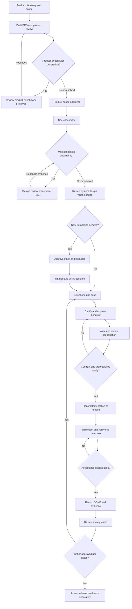
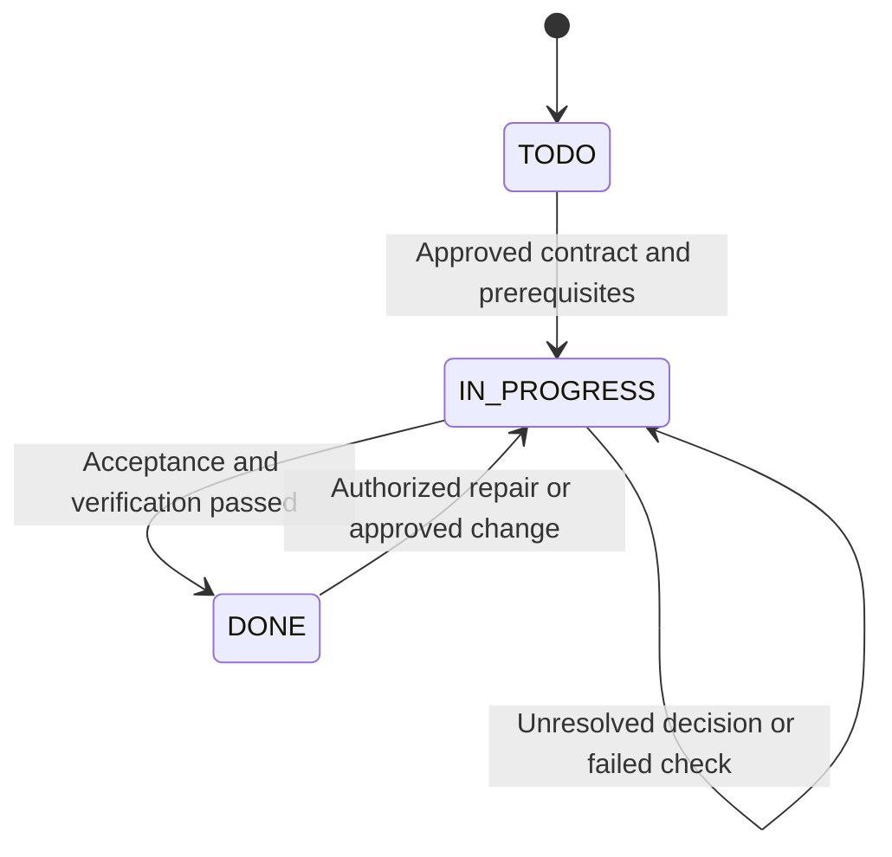

# Engineering Workflow

Status: F08 documented workflow for review (2026-11-28).
Scope: reusable software engineering workflows, not a prescribed application architecture.
Related: [Skill Catalog](skill-catalog.md), [design principles](skill-design-principles.md), [roadmap](roadmap.md), [remediation tracker](audits/remediation-plan.md).

This document maps existing skill contracts to engineering tasks. It is not a new orchestrator skill and does not authorize automatic invocation, additional work or file writes. Follow the user's requested scope, target repository conventions and each skill's activation restrictions. The documented workflow is not evidence of tested end-to-end agent behavior.

## 1. Select a workflow

| Mode | Use when | Minimum evidence |
| --- | --- | --- |
| Full SDD | New products, complex use cases, significant changes with uncertain behavior or dependencies | Agreed scope, use-case identity, approved behavior, verified implementation |
| Lightweight change | Bounded change in an existing project with clear intent and low ambiguity | Agreed change, affected scope, relevant tests and review |
| Defect diagnosis | Existing behavior fails, regresses or becomes slow | Reproduction or explicit blocker, root-cause evidence, targeted correction and regression check |

Escalate a lightweight change to specification or design when business rules, security boundaries, data migration, irreversible architecture decisions or cross-component contracts materially change. Do not restart product discovery for a small fix. Apply the smallest workflow that can establish confidence. If a use case is already governed by the SDD index/spec contract, preserve it even for a small change.

## 2. Full specification-driven development



The flow is iterative, not a mandatory waterfall. Domain modeling, decision interviews and prototypes may inform any relevant stage; unresolved decisions return to their owner. A design artifact cannot silently change approved product behavior.

### Stage contracts

| Stage | Existing skill | Input | Output and gate |
| --- | --- | --- | --- |
| Product discovery | [product-requirements](../engineering/product-requirements/SKILL.md) | Idea, users, problem and constraints | Confirmed summary; drafts PRD after confirmation |
| Requirements decomposition | [prd-to-use-cases](../engineering/prd-to-use-cases/SKILL.md) | Authoritative PRD, existing index if any | Use-case summary, preserved identities/statuses; resolve scope conflicts before writing |
| System design (as needed) | [system-design](../engineering/system-design/SKILL.md) | Product scope, existing architecture, constraints and quality drivers | Reviewable boundaries, tradeoffs, runtime and failure behavior, approved material decisions |
| Technical feasibility (as needed) | [technical-spike](../engineering/technical-spike/SKILL.md) | Explicit experiment request, technical hypothesis and bounded environment | Reproducible observations, verdict and limitations; design decision remains separate |
| Technical foundation | [project-foundation](../engineering/project-foundation/SKILL.md) | Product constraints, repository state | Approved stack and initialization method, runnable baseline, tech-stack.md and verification |
| Domain/design exploration (optional) | [domain-modeling](../engineering/domain-modeling/SKILL.md), [grilling](../engineering/grilling/SKILL.md), [grill-with-docs](../engineering/grill-with-docs/SKILL.md), [product-prototyping](../engineering/product-prototyping/SKILL.md) | Material domain or design question | Confirmed vocabulary/decisions or disposable experiment; not implementation approval |
| Behavior specification | [behavior-specification](../engineering/behavior-specification/SKILL.md) | Feature description or one UC ID, PRD and existing docs | Interview, confirmed behavior, one specification and new index row only if needed |
| Implementation planning (optional) | [html-plan](../engineering/html-plan/SKILL.md) | Approved behavior or requested design change, project context | Reviewable interactive HTML plan; await response before building |
| Implementation and verification | [implement-use-case](../engineering/implement-use-case/SKILL.md) | One approved specification, consistent index and prerequisites | Verified in-scope change, tests and synchronized status |
| Technology guidance | [spring-boot](../spring-boot-skills/spring-boot/SKILL.md) and relevant focused skills | Existing or approved Spring Boot context | Technical guidance, implementation constraints and checks |
| Code review | [java-code-review](../engineering/java-code-review/SKILL.md) | Requested Java diff or scope | Findings in review.md or requested path; no fixes without authorization |
| Release readiness | [spring-boot-testing](../spring-boot-skills/spring-boot-testing/SKILL.md), [spring-boot-cicd](../spring-boot-skills/spring-boot-cicd/SKILL.md) when relevant | Verified change and project release criteria | Scoped build/readiness evidence or requested CI configuration; no generic release owner yet |

Several engineering skills are explicitly invoked: consult the catalog and actual host configuration. A handoff recommendation does not bypass manual-only policy. No automatic chaining is implied. If a required skill is unavailable, report it and use a permitted documented fallback or ask the user.

### Foundation and generator selection

The foundation stage is normally needed for a new project, not every use case in an existing repository. The user approves the stack and initialization method separately. For Spring Boot, choose exactly one approved method: [spring-boot-scaffolding](../spring-boot-skills/spring-boot-scaffolding/SKILL.md) for Spring Initializr, or [progen](../engineering/progen/SKILL.md) when explicitly chosen and compatible. Verify the runnable skeleton and report any missing checks. Do not silently overwrite an existing project, switch generators or implement product features during initialization.

### Optional decision work

Use grilling for a requested stress-test of a design decision; it asks independent frontier questions in rounds. Use behavior-specification for feature behavior; it asks exactly one question per turn. Do not import the grilling interview format into behavior-specification. Use domain-modeling for canonical terms and significant domain decisions. Grill-with-docs composes grilling and domain-modeling and needs both dependencies. Record only confirmed decisions within the authorized documentation scope.

A prototype answers a bounded question and is disposable. The renamed product-prototyping skill supports product journeys, UI alternatives and interactive behavior simulations. The Phase 02 [prototype capability contract](contracts/prototyping.md) distinguishes these from technical feasibility experiments; technical-spike now owns explicitly authorized technical feasibility experiments. Product feedback returns to PRD, behavior feedback to the specification/domain owner, and technical evidence to the design/ADR owner. The prototype is not verified production code or implementation authorization. HTML plans present implementation decisions for review, not a second requirements authority.

## 3. Artifact contracts

All paths below are relative to the target project, not this skills repository. Honor explicit paths and established conventions.

| Artifact | Owner / authority | Default or existing location |
| --- | --- | --- |
| Product intent and scope | PRD; product-requirements drafts it | docs/PRD.md; legacy root PRD.md supported |
| Use-case identity and status | Requirements index; prd-to-use-cases, behavior-specification and implement-use-case update within their scope | docs/requirements.md |
| System design | system-design; approved architecture and existing ADRs | docs/system-design.md or established design location |
| Technical baseline | project-foundation | docs/tech-stack.md |
| Domain terminology | domain-modeling | GLOSSARY.md or context-local glossary |
| Significant domain/architecture decision | domain-modeling where appropriate | docs/adr/ or context-local ADRs |
| Detailed behavior and acceptance criteria | behavior-specification; approved specification | docs/specs/{number}-{feature-title}.md |
| Prototype evidence (proposed expansion) | Prototype question, artifact and verdict; authoritative decisions stay with PRD/spec/ADR owners | Project-selected isolated location and decision record |
| Implementation plan | html-plan when requested; otherwise existing project convention | User/project-selected HTML or plan location |
| Review findings | java-code-review | review.md unless specified |
| Test and build evidence | Implementing or reviewing skill and project tools | Actual test reports, logs and change summary |

The product brainstorming summary confirmation authorizes drafting the PRD; the resulting default PRD still has draft/pending approval metadata. Obtain or establish product scope approval before treating it as committed implementation scope. The PRD owner records explicit approval of the reviewed revision; the conversion skill checks scope authority and does not modify the PRD. Legacy authority conventions remain supported.

The requirements index contains summary rows (Icon, UseCase ID, Use Case Title, Status). Detailed behavior belongs in the specification; do not duplicate it in the index. Dependencies belong in specification metadata and in the index only when its existing convention includes them.

Example (illustrative, not an actual project requirement):

```markdown
| Icon | UseCase ID | Use Case Title | Status |
| --- | --- | --- | --- |
| ❎ | UC-007 | Cancel a pending booking | TODO |
```

The corresponding docs/specs/007-cancel-pending-booking.md uses metadata keys UseCase ID, Title, Depends On and Status, followed by Actors, Preconditions, UseCase Details, Business Rules, Acceptance Criteria, In Scope and Out of scope. The canonical ID, title and status must agree. Record dependencies using existing conventions. Allocate new IDs after the highest existing ID; never renumber or duplicate existing IDs. If the PRD and index disagree, reconcile product scope with the human; if the index and specification disagree, stop before editing implementation.

## 4. Approval and status lifecycle

| Gate | Required decision or evidence |
| --- | --- |
| Product scope | Human confirms material product decisions; distinguish approval of summary from approval of drafted PRD |
| Foundation | Human approves technical baseline and initializer separately |
| Behavior | Human confirms the interview outcome; review the specification before implementation |
| Plan | Where html-plan is used, wait for the user's response to its decisions |
| Start | One requested use case, consistent documents, clear prerequisites and approved behavior |
| Completion | All in-scope acceptance criteria implemented and relevant verification passed |
| Release | Separate explicit authorization, release criteria, credentials and applicable rights |



| Status | Index icon | Meaning |
| --- | --- | --- |
| TODO | ❎ | Not started |
| IN_PROGRESS | 👷🏽 | Started; incomplete or verification blocked |
| DONE | ✅ | Specified behavior implemented and relevant verification passed |

For implement-use-case, the first repository change after resolving blockers is to set both the index row and specification status to IN_PROGRESS, and read both back. Resume an existing IN_PROGRESS use case only when intent is clear. Do not update unrelated rows. If a required dependency is incomplete or its evidence is stale, stop or arrange separately authorized prerequisite work; a specific explicitly authorized exception must record risk and remaining verification obligations. Do not silently implement the dependency or waive acceptance evidence. If checks fail or required work remains, keep IN_PROGRESS and report evidence. When criteria pass, update both to DONE and read back both documents and the summary icon.

DONE is not a release or deployment approval. For a DONE use case with a new defect, explicit repair authorization is required. For authorized repair or approved change, reconcile behavior, identify stale evidence and affected dependents, then reopen both status records to IN_PROGRESS before implementation edits. Refresh affected evidence before DONE; do not invent additional status codes.

## 5. Change and failure handling

| Situation | Response |
| --- | --- |
| PRD changes scope | Update approved product intent first; assess affected rows, specs, dependencies and existing work; preserve IDs and obtain approval for material changes or removal |
| Existing requirement is regenerated | Preserve matching IDs and statuses; new rows begin TODO; reconcile legacy details explicitly |
| Implementation exposes ambiguity | Pause, clarify with the human and revise the specification through its owner; retain IN_PROGRESS if work started |
| Acceptance test fails | Capture evidence, correct the in-scope defect, rerun focused and relevant broader checks; do not mark DONE |
| Required check cannot run | Record NOT RUN and reason, remaining risk and missing prerequisite; do not claim verified completion |
| Architecture decision conflicts with scope | Reconcile the decision and affected contracts; do not use a technical preference to redefine behavior |
| Index/spec mismatch or multiple matching files | Stop before edits, identify the mismatch and obtain reconciliation |

The current skill set has no dedicated requirements change-control orchestrator. This section defines a coordination convention for reviewers and agents, not an implemented automated migration.

## 6. Lightweight change

For a clear, bounded change in an existing project:

1. Read repository instructions, relevant code and existing acceptance evidence.
2. Confirm the intended observable behavior and material exclusions. A short task description or existing issue may suffice.
3. Use relevant focused technical skills; do not load the entire Spring Boot collection or initialize a new project.
4. Implement the smallest complete change, add relevant tests, run checks and review the diff.
5. Report results and limitations; update existing documentation or specification status only when the task actually changes its contract and the relevant lifecycle applies.

If a change touches security, migration, cross-service compatibility or uncertain business rules, expand the review and specification effort accordingly. Use html-plan only when the user asks for that format or the skill's planning trigger applies; do not create redundant plans for routine edits.

## 7. Defect diagnosis and review

For hard defects or regressions, use [diagnosing-bugs](../engineering/diagnosing-bugs/SKILL.md): construct a reproducible, bounded red-capable signal, minimize the reproduction, test hypotheses against evidence, correct the cause and verify a regression check. If no reliable feedback loop is available, report the blocker and ask for the minimum authorized evidence. Redact secrets; never use uncontrolled production experimentation.

Use focused Spring Boot testing or JVM diagnostics guidance when relevant. A bug that changes expected behavior rather than restoring it requires product/specification reconciliation. Review is separate from repair: java-code-review reports concrete findings and evidence, and asks before overwriting an existing report or changing production code.

For handoffs across sessions, the collected handoff skill can capture context when explicitly invoked. A retrospective or teaching session is optional and must not be substituted for acceptance verification.

## 8. Coverage gaps and reuse-first priorities

| Capability | Existing coverage | Candidate next step |
| --- | --- | --- |
| Product requirements refinement | product-requirements drafts PRD; prd-to-use-cases creates index | Refine the renamed product-requirements contract in E03 |
| System design | project-foundation, domain-modeling, grilling and technology-specific architecture skills | Investigate cross-cutting system design covering boundaries, quality attributes, integration and trade-offs without duplicating existing owners |
| Implementation planning | html-plan and implement-use-case task decomposition | Assess a portable, format-neutral planning contract and reuse existing tools first |
| Test strategy | implement-use-case acceptance tests, diagnosing-bugs, spring-boot-testing | Investigate technology-neutral risk-based verification planning and measurable criteria |
| Prototyping | Product-prototyping UI and behavior modes | Product journey and behavior guidance and separate technical-spike implemented; runtime evaluation pending |
| Change control | Individual PRD/index/spec reconciliation rules | Clarify reopening, impact analysis and approval semantics in the existing workflow before proposing automation |
| Release readiness | Spring Boot build/testing and CI guidance | Investigate general release criteria and authorization; do not conflate with deployment |

These are candidates for Phase 2, not new implemented skills. Compare existing open-source capabilities, license, fit, verification and maintenance before adoption or original development. Do not add an orchestration skill solely to enforce the diagram.

## 9. Representative workflow acceptance cases

The following are proposed behavioral evaluation cases; they have not been executed in an agent runtime.

| Case | Expected evidence |
| --- | --- |
| New product to one approved use case | PRD approval distinguished from draft; stable index; foundation approved; one spec and implementation |
| Existing project, small endpoint change | No new project or unrelated architecture; focused verification |
| Regenerate index after a PRD addition | Existing IDs/statuses preserved; only new use case TODO |
| Existing legacy index with detailed behavior | No deletion without migration approval; detailed specification ownership respected |
| Index/spec status conflict | No implementation edits before reconciliation |
| Dependency not DONE | Explicit decision requested; no silent scope expansion |
| Failed acceptance test | Both status entries remain IN_PROGRESS; evidence reported |
| DONE use case repair | Explicit repair and agreed status handling; regression evidence |
| Missing delegated generator or skill | Limitation reported; no fabricated invocation or unauthorized substitution |
| Hard regression without reproduction | Blocker reported rather than speculative implementation |

Use equivalent baseline tasks and the [authoring guide](skill-authoring-guide.md) for evaluation. Record actual results separately. A documented contract is not a behavioral pass.
