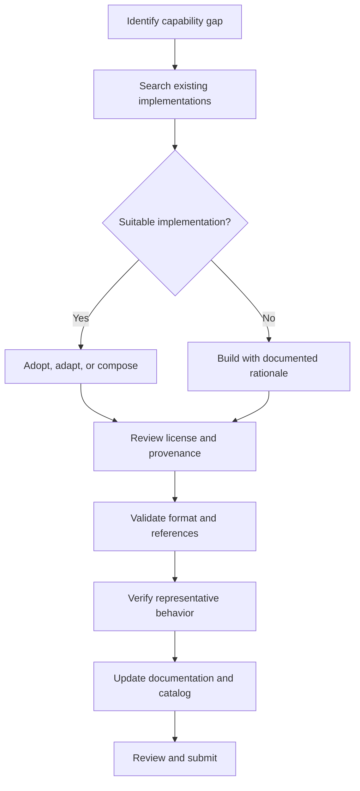

# Phase 01 — Repository Foundations

Status: Proposed  
Parent: [Agent Skills Roadmap](../roadmap.md)

## 1. Objective

Establish a maintainable foundation for the existing skill library before expanding its scope. Prioritize existing open-source standards, skills, and tools over custom implementations.

The reviewed baseline contains 59 skill entry points: 13 engineering, 39 Spring Boot, and 7 collected skills. Refresh the inventory at execution time.

## 2. Scope and non-goals

In scope: standards and compatibility, repository instructions, skill design and authoring conventions, contribution rules, baseline audit, catalog, engineering workflow documentation, distribution verification, and deterministic CI checks.

Out of scope: mass skill creation, disruptive directory migrations, full remediation of every audit finding, custom installation tools, and comprehensive model-based evaluations (Phase 3).

## 3. Reuse-first policy

For every proposed skill or tool, evaluate existing implementations before writing new code:

| Decision | When to use |
| --- | --- |
| Adopt | Existing implementation meets requirements without changes |
| Adapt | Existing implementation meets most requirements and can be maintained with focused modifications |
| Compose | Combining existing capabilities meets the requirements |
| Build | No suitable implementation exists or material limitations justify custom work |

Evaluate correctness, maintenance activity, licensing, compatibility, verification evidence, security, adoption, and maintenance cost. Popularity alone is insufficient. Record upstream repository, path, pinned revision, license, local changes, and update strategy for imported or adapted skills. Prefer external tool usage over vendoring where practical.

## 4. Candidate open-source references

These are candidates for investigation, not verified dependencies or approved imports. Confirm current availability, license, commands, compatibility, and maintenance status before adoption.

| Project | Candidate use |
| --- | --- |
| [Agent Skills](https://github.com/agentskills/agentskills) | Open skill specification and skills-ref validation |
| [Anthropic Skills](https://github.com/anthropics/skills/tree/main/skills/skill-creator) | Skill creation, trigger optimization, and evaluation workflows |
| [OpenAI Skills](https://github.com/openai/skills) | Codex-oriented skill creation and installation guidance |
| [Skills CLI](https://github.com/vercel-labs/skills) | Discovery and installation |
| [AGENTS.md](https://github.com/agentsmd/agents.md) | Repository-level agent instructions |
| [SkillsJars Maven Plugin](https://github.com/skillsjars/skillsjars-maven-plugin) | Existing Maven packaging and extraction approach |
| [markdownlint-cli2](https://github.com/DavidAnson/markdownlint-cli2) | Markdown linting |
| [lychee](https://github.com/lycheeverse/lychee) | Link checking |

Reuse the repository's existing [AGENTS.md prompt](../prompts/create-agentsmd.prompt.md) and [README prompt](../prompts/create-readme.prompt.md) where useful. Do not duplicate official skill-creator functionality in this phase.

## 5. Work items

All items are initially TODO. P0 denotes essential foundation work; P1 denotes supporting work within this phase.

| ID | Task | Deliverable | Priority | Dependencies |
| --- | --- | --- | --- | --- |
| F01 | Standards and compatibility | docs/skill-compatibility.md | P0 | None |
| F02 | Agent instructions | AGENTS.md | P0 | F01, F03, F04 |
| F03 | Skill design principles | docs/skill-design-principles.md | P0 | F01, F06 |
| F04 | Skill authoring guide | docs/skill-authoring-guide.md | P0 | F01, F03 |
| F05 | Contribution guide | CONTRIBUTING.md | P1 | F03, F04 |
| F06 | Baseline audit | docs/audits/initial-skill-audit.md | P0 | F01 |
| F07 | Skill catalog | docs/skill-catalog.md | P1 | F06 |
| F08 | Engineering workflow | docs/engineering-workflow.md | P1 | F06 |
| F09 | Distribution verification | docs/verification/distribution.md | P0 | F01, F07 |
| F10 | Deterministic validation and CI | Validation tooling and CI configuration | P1 | F01, F03, F07, F09 |

### F01 — Standards and compatibility

Study the Agent Skills specification and supported agents' official documentation. Establish required and optional frontmatter, naming, progressive disclosure, discovery and installation, portable versus platform-specific metadata, and validation tooling.

Acceptance: document the applicable standard, source revisions or access dates, compatibility matrix, selected tools, unresolved questions, and reuse decisions. Distinguish documented behavior from tested behavior.

### F02 — AGENTS.md

Use the existing prompt and AGENTS.md guidance. Define repository scope, source-of-truth hierarchy, reuse-first policy, editing rules, verification requirements, attribution, documentation synchronization, and change boundaries.

Acceptance: concise, actionable repository instructions consistent with the approved design and authoring guides, without duplicating detailed reference material.

### F03 — Skill design principles

Define single responsibility, composability, progressive disclosure, evidence-based guidance, minimal context, portability, verifiability, maintainability, and traceability.

Acceptance: principles provide concrete review criteria for activation, scope, references, scripts, version-sensitive guidance, and skill interaction.

### F04 — Skill authoring guide

Adapt official skill-creator guidance to the repository. Cover discovery, selection, adoption, adaptation, composition, original creation, directory layout, validation, representative usage checks, attribution, documentation updates, and maintenance.



Acceptance: a contributor can follow the guide end to end without inventing a parallel skill standard or evaluation framework.

### F05 — Contribution guide

Document contribution types, prerequisites, setup, skill changes, upstream attribution, testing, pull requests, and review expectations.

Acceptance: contributors know which checks and evidence are required; commands are verified or explicitly marked provisional.

### F06 — Baseline audit

Inventory all actual SKILL.md files. Assess standard compliance, activation, responsibility, overlap, references, scripts, technical currency, source/license, compatibility, and verifiability.

Record per-skill findings, severity, evidence, and disposition: retain, improve, merge, replace, deprecate, or investigate. Do not remove or merge skills solely on the basis of the audit.

Acceptance: every discovered skill has an audit record, unresolved findings are visible, and remediation is prioritized separately.

### F07 — Skill catalog

Provide skill name, description, collection, path, provenance, and compatibility where established. Prefer generation from the source tree using existing tools or minimal glue code; avoid maintaining duplicate inventories manually.

Acceptance: catalog coverage matches discovered entries, links resolve, and generation or update instructions are documented.

### F08 — Engineering workflow

Map existing engineering skills to product discovery, requirements, project foundation, behavior specification, implementation, debugging, and review. Describe when full SDD is appropriate, lightweight alternatives, artifacts, approval boundaries, status transitions, requirement changes, and verification failures.

Acceptance: responsibilities and handoffs are clear; gaps and inconsistencies are documented instead of inventing implemented capabilities.

### F09 — Distribution verification

Test the following against the intended skill inventory:

| Check | Expected evidence |
| --- | --- |
| Skills CLI discovery | Discovered entries and comparison against source inventory |
| Codex installation | Installed paths and representative skill discovery |
| Claude Code installation | Installed paths and representative compatible skill discovery |
| Maven build | Command, environment, exit status, and relevant output |
| JAR contents | Expected skill files and resources compared with actual contents |
| SkillsJars extraction | Restored directories and resource integrity |
| CI and publishing | Workflow configuration and available run evidence; no release triggered solely for testing |

Candidate commands include the existing Maven Wrapper build and Skills CLI listing; verify exact CLI syntax before execution. Use temporary locations for installation tests. Do not publish artifacts or modify external agent settings without approval.

Acceptance: record versions, commands, results, gaps, and blocked checks. A failed or unavailable check is not a pass. Resolve critical distribution failures or explicitly narrow supported distribution claims.

### F10 — Deterministic checks and CI

Prefer skills-ref for specification validation, markdownlint-cli2 for Markdown, lychee for links, and existing CI workflows. Add only necessary glue for recursive discovery, duplicate names, local references, catalog freshness, and package contents.

Possible implementation paths (not fixed):

- scripts/validate-skills.py
- scripts/generate-catalog.py
- .github/workflows/validate-skills.yml

Acceptance: chosen checks run locally and in CI, failure output is actionable, dependencies are pinned appropriately, and representative invalid inputs are detected. Document exceptions rather than silently ignoring failures.

## 6. Execution order

1. Research standards and reusable tools (F01).
2. Audit the existing inventory (F06).
3. Establish design principles and authoring guide (F03, F04).
4. Write repository and contribution instructions (F02, F05).
5. Document the workflow and catalog (F07, F08).
6. Verify distribution (F09).
7. Integrate deterministic checks (F10).
8. Review phase acceptance criteria and record remaining issues.

## 7. Target deliverables

```text
AGENTS.md
CONTRIBUTING.md
docs/
├── roadmap.md
├── plans/
│   └── phase-01-repository-foundations.md
├── skill-compatibility.md
├── skill-design-principles.md
├── skill-authoring-guide.md
├── skill-catalog.md
├── engineering-workflow.md
├── audits/
│   └── initial-skill-audit.md
└── verification/
    └── distribution.md
```

Add scripts and CI configuration only after tool selection. Do not create placeholder skill collections.

## 8. Phase acceptance checklist

- [ ] Standards, compatibility, and reuse decisions documented.
- [ ] Repository instructions, design principles, authoring and contribution guides established.
- [ ] All discovered skills audited and findings prioritized.
- [ ] Catalog matches the actual inventory.
- [ ] Current engineering workflow and handoffs documented.
- [ ] Installation and packaging verified for declared supported methods, with limitations recorded.
- [ ] Deterministic checks integrated into CI and demonstrated.
- [ ] Upstream sources and applicable licenses traceable, or unresolved cases explicitly recorded and restricted from redistribution as appropriate.
- [ ] Phase review records verification evidence, remaining blockers, and follow-up tasks.

## 9. Decisions to resolve during implementation

- Officially supported agents and installation methods.
- Validator and dependency installation approach.
- Catalog generation versus checked-in output.
- Intended Maven package coverage and nested skill handling.
- Policy for upstream revisions, licenses, and updates.
- CI enforcement thresholds and handling of pre-existing findings.

No implementation or verification is claimed by this plan. Record evidence as work is completed.
