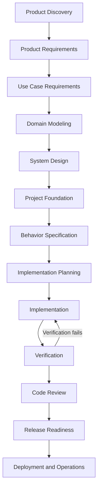

# Agent Skills Roadmap

Status: Phases 01–03 deterministic infrastructure implemented on review branch; behavioral acceptance pending

## 1. Vision

Evolve this repository into a reusable software engineering skill library for AI coding agents, rather than a collection of disconnected prompts. Prioritize reliable engineering workflows, focused technical guidance, and measurable skill quality over the number of skills.

## 2. Current baseline

The repository currently organizes skills into three collections:

| Collection | Skills at baseline | Scope |
| --- | ---: | --- |
| [Engineering](../engineering/) | 13 | Product discovery, requirements, domain modeling, project foundation, specifications, implementation, debugging, and review |
| [Spring Boot](../spring-boot-skills/) | 39 | Spring Boot 4 architecture, development, testing, integration, and delivery |
| [Collected Skills](../collected-skills/) | 7 | Reusable skills gathered from other projects |

Reusable prompts live in [docs/prompts](prompts/). Maven packaging is configured in [pom.xml](../pom.xml), and CI, snapshot, and release workflows exist under [.github/workflows](../.github/workflows/).

The counts describe the reviewed baseline, not a permanent inventory. See the [generated catalog](skill-catalog.md), [baseline audit](audits/initial-skill-audit.md), and [Phase 01 review](reviews/phase-01-review.md). Local archive, extraction and installation verification passed for the reviewed inventory; runtime behavior and publication remain unverified.

## 3. Goals and design principles

- Cover the software development lifecycle without imposing unnecessary process on small changes.
- Separate engineering methods from technology-specific guidance.
- Give each skill a clear activation condition, responsibility, and completion criterion.
- Prefer composition and focused references over large, overlapping skills.
- Reuse mature open-source standards, skills, and tools first: adopt, adapt, or compose before building custom implementations. Evaluate licensing, maintenance, correctness, compatibility, and verification evidence; record provenance and local changes.
- Preserve user decisions and distinguish confirmed requirements from assumptions.
- Ground technical guidance in maintained primary sources and executable examples where practical.
- Measure whether skills improve agent behavior compared with an equivalent task without skills.
- Maintain attribution, licenses, compatibility information, and reproducible distribution.
- Avoid speculative skill creation and disruptive directory migrations.

## 4. Engineering capability expansion

The following candidates are proposals, not commitments. Review existing skill contracts before creating new entries; extend or compose an existing skill when that is sufficient.

| Capability | Candidate skill | Priority |
| --- | --- | --- |
| Product requirements | product-requirements | P0 |
| System design | system-design | P0 |
| Implementation planning | implementation-planning | P0 |
| Test strategy | test-strategy | P0 |
| Domain-driven design | domain-driven-design | P1 |
| Architecture decisions | architecture-decision-record | P1 |
| Database design | database-design | P1 |
| API design | api-design | P1 |
| Requirements traceability | requirements-traceability | P1 |
| Threat modeling | threat-modeling | P1 |
| Refactoring | refactoring | P1 |
| Release readiness | release-readiness | P1 |
| Incident response | incident-response | P2 |
| Documentation maintenance | documentation-maintenance | P2 |

P0 denotes near-term priorities, P1 subsequent improvements, and P2 longer-term opportunities. These priorities do not imply delivery dates.

## 5. Specification-driven development

Extend the current workflow through explicit contracts between stages. The following is an illustrative target, not a mandatory sequence for every change.



Preserve the existing requirements index and use-case lifecycle defined by behavior-specification and implement-use-case. A use case is complete only after its specified behavior is implemented and relevant verification passes. Design and foundation decisions may be iterative; small fixes may bypass unnecessary discovery stages.

### Engineering artifacts

| Artifact | Purpose |
| --- | --- |
| project-charter.md | Project goals, scope, assumptions, and success criteria |
| prd.md | Product intent and requirements |
| requirements.md | Use-case index, dependencies, and implementation status |
| domain-model.md | Domain concepts, relationships, and invariants |
| architecture.md | System boundaries and design decisions |
| tech-stack.md | Approved technologies and versions |
| adr/*.md | Significant architecture decisions and trade-offs |
| database-design.md | Data model, integrity, and persistence decisions |
| api-design.md | Interface contracts and compatibility |
| specs/*.md | Approved behavior, business rules, and acceptance criteria |
| plans/*.md | Implementation tasks and verification approach |
| test-strategy.md | Risk-based verification strategy |
| release-checklist.md | Release and operational readiness |

These are optional artifacts selected according to complexity and risk. Existing document conventions take precedence; avoid duplicating authoritative information across documents.

Each workflow skill should describe inputs, outputs, prerequisites, approval boundaries, failure handling, and handoff to the next relevant skill.

## 6. Technical capability expansion

Introduce technology collections incrementally, based on demonstrated needs and gaps in existing guidance.

| Proposed collection | Potential scope |
| --- | --- |
| java-skills/ | Language features, concurrency, JVM, performance, and coding conventions |
| frontend-skills/ | TypeScript, React, Vue, Next.js, and frontend architecture |
| database-skills/ | PostgreSQL, Redis, SQL optimization, and database design |
| distributed-system-skills/ | Messaging, consistency, distributed transactions, and service governance |
| devops-skills/ | Containers, Kubernetes, CI/CD, and infrastructure |
| security-skills/ | Threat modeling, identity, authorization, and security review |
| testing-skills/ | Unit, integration, contract, and end-to-end testing |
| ai-skills/ | LLM applications, retrieval, MCP, agents, and evaluation |

Several topics already exist within spring-boot-skills. Extract technology-neutral guidance only when reuse justifies it, preserve framework-specific responsibilities, and maintain working references during migrations.

## 7. Skill engineering

### 7.1 Directory conventions

```text
skill-name/
├── SKILL.md
├── references/
├── scripts/
├── assets/
├── examples/
└── evals/
```

Only SKILL.md is required. Other directories are optional and should contain material needed by the skill. Keep the entry point focused; load references progressively. Scripts should have documented inputs, dependencies, and effects.

### 7.2 Skills for maintaining skills

Consider a dedicated skill-engineering collection:

| Candidate | Responsibility |
| --- | --- |
| skill-authoring | Create focused, reusable skills |
| skill-review | Review correctness, scope, and responsibility boundaries |
| skill-evaluation | Define evaluation cases and scoring |
| skill-optimization | Improve activation, context efficiency, and execution |
| skill-maintenance | Update stale references and version-sensitive guidance |
| skill-discovery | Select and compose relevant skills |

Establish the authoring standard and evaluation approach before implementing the entire collection.

### 7.3 Evaluation framework

| Dimension | Evidence |
| --- | --- |
| Activation accuracy | Positive, negative, and ambiguous trigger cases |
| Instruction adherence | Required steps, approvals, and stop conditions |
| Output quality | Observable correctness of artifacts or code |
| Scope control | No unauthorized or unnecessary changes |
| Technical accuracy | Version compatibility and primary-source verification |
| Context efficiency | Relevant references loaded without excessive context |
| Composition | Compatible instructions across multiple skills |
| Regression | Stable behavior after skill changes |

Start with behavior-specification, implement-use-case, project-foundation, and the spring-boot entry skill. Include cases for ambiguous requirements, missing dependencies, failed verification, incorrect routing, and scope expansion. Compare matched tasks with and without skills, record model and tool versions, and report variability rather than treating one run as conclusive.

### 7.4 Automated checks

| Check | Expected outcome |
| --- | --- |
| Frontmatter validation | Required metadata parses correctly |
| Skill naming | Names follow the chosen convention and match directories |
| Uniqueness | No unintended duplicate skill names |
| Markdown lint | Consistent document formatting |
| Local link and reference checks | Referenced files exist |
| Catalog generation | Inventory reflects the actual tree |
| Packaging checks | Built artifacts include the intended skills and resources |
| Installation smoke tests | Supported installation paths work |
| Skill evaluations | Behavioral regressions are identified |

Run deterministic checks on pull requests. Introduce model-based evaluations separately, with controlled cost and explicit reporting. Verify nested skill discovery and Maven packaging before advertising full artifact coverage.

## 8. Proposed long-term repository structure

```text
skills/
├── engineering/
├── spring-boot-skills/
├── java-skills/
├── frontend-skills/
├── database-skills/
├── distributed-system-skills/
├── devops-skills/
├── security-skills/
├── testing-skills/
├── ai-skills/
├── skill-engineering/
├── collected-skills/
├── docs/
│   ├── roadmap.md
│   ├── skill-design-principles.md
│   ├── skill-authoring-guide.md
│   ├── skill-catalog.md
│   ├── engineering-workflow.md
│   └── prompts/
├── scripts/
│   ├── validate-skills.py
│   └── generate-catalog.py
├── evals/
├── .github/
├── AGENTS.md
├── CONTRIBUTING.md
├── CHANGELOG.md
├── README.md
└── pom.xml
```

This is a target layout, not an instruction to create empty directories or immediately reorganize the repository. Add collections only when useful skills and ownership boundaries are established.

## 9. Implementation roadmap

| Phase | Objective | Main deliverables | Exit criteria |
| --- | --- | --- | --- |
| 1 | [Repository foundations](plans/phase-01-repository-foundations.md) | Standards, agent instructions, authoring and contribution guides, baseline audit, catalog, workflow documentation, distribution verification, deterministic CI checks | Conventions documented; skills audited; supported distribution verified; baseline checks integrated |
| 2 | [Engineering workflow](plans/phase-02-engineering-workflow.md) | Responsibility audit, system design, implementation planning, test strategy, artifact contracts | Overlap resolved; representative workflow documented and exercised |
| 3 | [Quality engineering](plans/phase-03-quality-engineering.md) | Extend deterministic checks and introduce systematic model-based evaluations and regression testing | Initial behavioral baseline recorded; evaluation and regression processes established |
| 4 | [Technical expansion](plans/phase-04-technical-expansion.md) | Prioritized Java, frontend, data, distributed systems, security, testing, and delivery guidance | New skills address demonstrated gaps and meet the quality standard |
| 5 | Distribution and sustainability | Installation verification, versioning, release notes, maintenance and contribution processes | Supported distribution paths verified; maintenance responsibilities documented |

### Immediate work

Review the [Phase 01 acceptance report](reviews/phase-01-review.md) and [Phase 02 implementation plan](plans/phase-02-engineering-workflow.md). Phase 01 foundation deliverables and scoped deterministic verification are complete on the review branch; maintainer acceptance, runtime evidence and publication clearance remain separate. See the [Phase 02 review](reviews/phase-02-review.md) for implemented capabilities, deterministic evidence and outstanding behavioral acceptance. See the [Phase 03 review](reviews/phase-03-review.md): deterministic infrastructure verified, behavioral acceptance still open in both Phases 02 and 03. [Phase 04 discovery plan](plans/phase-04-technical-expansion.md) is proposed; new capability implementation requires demonstrated gaps, rights and verification.

## 10. Success criteria

- Documentation and catalog stay consistent with the source tree.
- Every skill has a clear purpose and documented boundary.
- Core workflow skills preserve requirements, approvals, and verification evidence.
- Supported distribution mechanisms are verified rather than assumed.
- New skills are justified by actual gaps and evaluated against representative tasks.
- Upstream sources and applicable licenses remain traceable.

## 11. Open decisions

- Which coding assistants and installation methods are officially supported?
- Which metadata conventions are portable, and which require tool-specific handling?
- Should the catalog be generated, checked in, or both?
- How should nested skills be packaged and distributed?
- Which evaluation runner, models, and cost budget should be used?
- Which existing Spring Boot guidance merits extraction into independent collections?
- What contribution, compatibility, and release policies should be adopted?

Resolve these decisions incrementally. This roadmap is a planning document; it does not claim that proposed skills, checks, or evaluations are already implemented.
