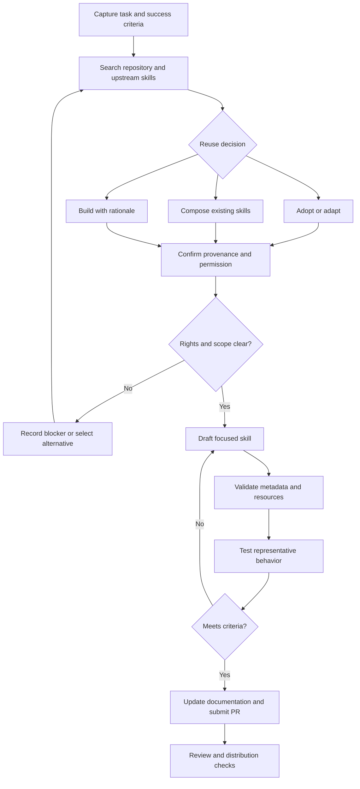

# Skill Authoring Guide

Status: F04 repository authoring baseline for review.
Applies to new, imported, adapted, composed and materially changed skills.
Read [Skill Design Principles](skill-design-principles.md) first; that document defines the acceptance rules. This guide explains how to apply them.

## 1. Tools and references

Reuse the host's skill-creator when available. The upstream [Anthropic skill-creator](https://github.com/anthropics/skills/tree/e4bb5d960d87126ff3b3a8af1a104b7db67560ba/skills/skill-creator) was reviewed at the pinned revision; it provides intent capture, drafting, representative test prompts, comparison with a baseline, iterative evaluation and trigger optimization. Use its implementation and schemas where appropriate instead of creating a second evaluation framework. Host-specific execution steps are not portable requirements.

Other references: [Agent Skills specification](https://agentskills.io/specification), [Codex skills](https://developers.openai.com/codex/skills), [Claude Code skills](https://code.claude.com/docs/en/skills), [repository compatibility matrix](skill-compatibility.md), and [distribution verification](verification/distribution.md).

## 2. Authoring workflow



### Step 1 — Capture intent

Identify one representative task, the target users or agents, expected inputs and outputs, activation and exclusions, required tools, consequential decisions, and measurable or reviewable completion criteria. Extract settled decisions from the current context rather than repeating questions. Clarify material uncertainties before implementing.

Record a brief capability statement and two or three realistic prompts. Include at least one nearby task that should not activate the skill. For a change to an existing skill, identify the observed defect and preserve an unchanged baseline for comparison.

### Step 2 — Discover and select

Search existing SKILL.md descriptions and workflows before external repositories. Search maintained upstream implementations and official host tools. Read the actual skill and supporting resources, not only the README or star count.

Record candidate links, capability fit, limitations, dependencies, maintenance evidence, license, compatibility and the adopt/adapt/compose/build decision. Prefer reuse without duplication. If a focused skill already owns the requested task, improve or compose it rather than introducing a competing trigger.

### Step 3 — Establish provenance before copying

For adoption or adaptation, pin the exact upstream commit and path; inspect license and notice files, metadata and supporting resources at that revision. Preserve applicable notices verbatim. If the permission is unclear, do not import or publicly redistribute the candidate until resolved; choose a suitable alternative.

For composition, identify each dependency and its version or source where appropriate. For original creation, record original authorship based on actual evidence and the applicable repository license. Never assume public source code or matching content is licensed for reuse.

Update the [provenance register](skill-provenance.md). For imported skills, add a local SOURCE.md with the fields in [design principles, section 9](skill-design-principles.md#9-traceability-and-license-management). Keep the source's original LICENSE/NOTICE files where individual installation preserves them. Mark missing grants or exact notices as unresolved rather than fabricating them.

### Step 4 — Choose collection and resources

| Collection | Scope |
| --- | --- |
| engineering | Reusable software engineering methods and workflows |
| spring-boot-skills | Spring Boot-specific technical guidance |
| collected-skills | Other collected general-purpose capabilities |

Do not create a new collection unless the scope warrants it and the packaging, inventory and verification rules are updated together.

Suggested layout (only SKILL.md is universally required):

```text
skill-name/
├── SKILL.md
├── SOURCE.md        # imported/adapted provenance
├── LICENSE          # applicable original license notice
├── NOTICE           # when applicable
├── agents/          # host-specific configuration
├── references/      # on-demand knowledge
├── scripts/         # deterministic operations
├── assets/          # output resources
├── templates/       # reusable source templates
└── examples/        # representative examples
```

Do not create empty directories. Follow established collection conventions. Keep transient evaluation workspaces outside packaged skill directories, because the current packaging and installation checks include skill-local resources. Use the upstream skill-creator evaluation workspace conventions when running its tooling.

### Step 5 — Write the entry point

The following is an illustrative structure, not a mandated heading template.

```markdown
---
name: example-review
description: Review a proposed code change against approved acceptance criteria and report verification gaps. Use for review requests, not feature implementation.
---

# Example Review

## Purpose
Review one proposed change without expanding its scope.

## Inputs
The change, approved acceptance criteria and available test evidence.

## Workflow
1. Inspect the relevant change and criteria.
2. Identify unmet behavior and missing evidence.
3. Report findings with locations and severity.

## Completion
Report findings, verified checks, and unresolved gaps. Do not claim
that unexecuted tests passed or modify the change without authorization.
```

Use valid directory-matching names and concise descriptions within standard field limits. Put activation in the description. Keep essential decision points, authorization, failure behavior and completion criteria in the entry point. Explain non-obvious constraints briefly. Link detailed references where they are needed rather than loading all of them at activation.

Specify how dependencies are found, what information is passed and what happens when they are unavailable. Preserve existing project conventions and approved decisions. Use examples for ambiguity, not as a substitute for general instructions.

For explicit-only skills, retain the Claude Code disable-model-invocation declaration and matching Codex agents/openai.yaml policy where applicable. See the compatibility document; do not assume these extensions are portable to every consumer. Do not add an invocation restriction merely because a skill writes files; design the policy according to the intended activation and actual risk.

Scripts should perform deterministic tasks that benefit from executable code. Document required runtime, parameters, outputs, side effects, failure behavior and a safe test invocation. Inspect external scripts before running them. Keep credentials and user-specific data out of committed examples.

## 3. Verification

### Static and distribution checks

Use an isolated Python environment with Python 3.11 or later (CI uses 3.12), JDK 17 and a compatible Node 22 release (upstream Skills CLI 1.9.1 declares >=22.20.0). The existing PR workflow uses these tools. From the repository root:

```sh
python -m pip install 'skills-ref @ git+https://github.com/agentskills/agentskills.git@83021e2be457a9b6679148719c1f6074f0ad975e#subdirectory=skills-ref'
python scripts/validate-skill-metadata.py
python -m unittest discover -s scripts -p 'test_*.py'
./mvnw clean verify -B -ntp
python scripts/verify-skill-jar.py target/skills-0.1.0-SNAPSHOT.jar
```

Use the actual main JAR path when the project version changes. The metadata wrapper validates a portable projection and known host policy extensions; it is not a strict export tool. The upstream reference revision is pinned, but transitive dependencies are not fully locked.

For discovery, from an approved checkout:

```sh
npx --yes skills@1.9.1 add "$PWD" --list
```

The [skill verification workflow](../.github/workflows/skill-verification.yml) additionally installs all skills into an isolated temporary project for both supported target layouts and tests local SkillsJars extraction. Reuse its commands and comparison scripts instead of modifying global agent directories. No deployment is required. Check new or changed references manually as well: the installed link check covers simple resolvable entry-point links, not every Markdown link or script dependency.

These commands are grounded in existing CI evidence in the distribution report. They depend on the review branch until merged; they are not a claim that every command has run locally in the contributor's environment.

### Representative behavior

Define expected behavior before evaluating. Use fresh sessions, equivalent inputs and the same model version, tool permissions and project baseline. Compare a new skill against no-skill behavior; for a changed skill compare against the unchanged version and, where useful, no-skill behavior.

| Case | Example for project-foundation | Expected observation |
| --- | --- | --- |
| Positive | Establish the foundation for an agreed product | Resolve material technical decisions and record approved baseline |
| Negative | Fix one existing endpoint | Do not reinitialize the project |
| Boundary | User approved stack but not initializer | Request initializer approval; no generation |
| Failure | Approved generator is unavailable | Report limitation and propose permitted alternatives |

For objective outputs, use programmatic assertions where practical. For qualitative outputs, use an explicit human-review rubric. Include activation, scope adherence, approvals, artifact correctness, relevant failure handling and regressions. Record actual token usage and latency only when available; line count is not a substitute.

If using Anthropic skill-creator, follow its pinned evaluation schema, baseline workflow and review tools. Do not copy the upstream runner into this repository. Iterate based on evidence, not simply stronger wording or longer instructions. Optimize descriptions using both positive and negative trigger cases. Broader model-based evaluation infrastructure remains Phase 3 work.

If actual agent execution is unavailable, record NOT RUN with the reason, fixtures or proposed cases and remaining risk. Do not turn static or installation checks into a behavioral pass.

## 4. Submit and maintain

Before opening a PR, review the diff against the [design checklist](skill-design-principles.md#11-review-criteria), update affected collection indexes and the provenance register, and update the catalog when it exists. For a workflow change, synchronize affected artifact contracts and relevant documentation. Keep historical audits intact; update remediation evidence separately.

The PR description should state:

- Task and observed gap; reuse decision and alternatives.
- Changed skill paths and scope boundaries.
- Upstream revision, applicable license, preserved notices and local changes, or original authorship.
- Representative cases, exact checks and results (PASS, FAIL, NOT RUN), and remaining risks.
- Compatibility, dependency, distribution and migration effects.

Review and correct failures before merging. Unresolved rights or publishing authorization are release blockers, even when CI is green. Do not publish, deploy, change global settings or merge a release-triggering PR merely to verify a skill.

For subsequent updates, compare the pinned upstream revision with the proposed revision and local modifications. Review changed license and dependencies, retain intentional local behavior, run relevant regression checks, update provenance and record evidence. Deprecate or merge skills only after reviewing their users, dependencies and migration impact.

## 5. Definition of done

A skill change is ready for review when its purpose and scope are clear, provenance and permissions are accounted for, relevant design rules are met, deterministic verification passes, and behavioral evidence or explicitly documented limitations are available. Review acceptance, merge and publication are distinct decisions. Do not declare a blocked check complete or treat this guide as authorization to distribute third-party content.
