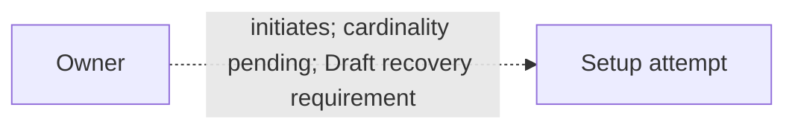

# Example: Device setup recovery contract

**PRD status:** Draft 
**Gate result:** Exploratory 
**Updated:** 2026-10-20 
**Assessment scope:** Setup recovery behavior only 
**Contract acceptance:** Pending 
**Related PRD:** Product behavior for helping a new owner recover from setup failure.

## PRD contract coverage

| PRD requirement | Domain contract disposition | API contract disposition | Canonical contract(s) | Decision / gap |
| --- | --- | --- | --- | --- |
| Draft requirement: an owner can recover after a setup failure | Exploratory | Exploratory | Proposed domain design and API contract | PRD is Draft; decide the recovery lifecycle and exposed failure reasons before accepting either contract |

## Domain design

### Domain models

| Model | Meaning / responsibility | Key domain attributes | Identity / lifecycle | PRD requirement |
| --- | --- | --- | --- | --- |
| Setup attempt | A bounded attempt to complete device setup. | Status, failure reason, start time, completion time | Identity and allowed states need contract review | Draft PRD behavior |
| Owner | The user authorized to initiate or recover setup. | None defined by this feature | Identity comes from the authenticated account context | Draft PRD behavior |

### Model relationships

### Shared domain rules

- **Invariants:** A caller may recover only a setup attempt they are authorized to access.
- **Lifecycle:** Allowed transitions, retry limits, and whether recovery resumes or creates an attempt need product decisions before the contract is accepted.
- **Authorization / trust boundary:** The server determines ownership and recovery permission from authenticated context.

## API contract — required

### Setup recovery

| Method and resource | PRD requirement | Purpose | Request | Response / status | Authorization | Errors / semantics |
| --- | --- | --- | --- | --- | --- | --- |
| `POST /device-setups/{setupId}/recover` (illustrative only) | Draft recovery requirement | Request recovery for an owned device setup | <fields pending contract review> | <response pending> | Authenticated owner or permitted operator | Unknown setup, unauthorized owner, and invalid setup state need defined outcomes |

The PRD is Draft, so this operation is illustrative and must not be treated as an accepted API contract.

## Open questions and conflicts

| Item | Impact | Decision needed from |
| --- | --- | --- |
| Does recovery restart the current attempt or create a new attempt? | Determines the recovery lifecycle and API semantics. | Product |
| Which failure reasons are safe and useful to expose? | Affects user understanding and information disclosure. | Product and Security |
| What retry limit or cooldown, if any, is required? | Affects recovery behavior and abuse controls. | Product and Security |

## Appendix

### Related documents

- PRD: Draft product behavior for setup recovery; path not established
- Design/API contracts: Not established; proposals are recorded in this exploratory assessment

### Supporting material (optional)

- No additional evidence was supplied.

### Revision history

| Date | Gate result | Change / decision |
| --- | --- | --- |
| 2026-10-20 | Exploratory | Initial assessment; PRD remains Draft |

This example illustrates the contract questions to resolve; it does not prescribe an endpoint or claim the behavior is approved.
