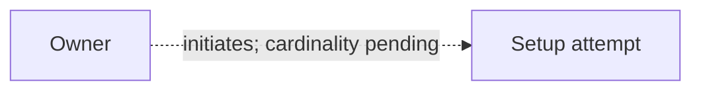

# Example: Device setup recovery contract

**PRD status:** Approved 
**Gate result:** Blocked 
**Updated:** 2026-10-20 
**Assessment scope:** Setup recovery behavior only 
**Contract acceptance:** Pending 
**Related PRD:** Product behavior for helping a new owner recover from setup failure.

## PRD contract coverage

| PRD requirement | Domain contract disposition | API contract disposition | Canonical contract(s) | Decision / gap |
| --- | --- | --- | --- | --- |
| Approved requirement: an owner can recover after a setup failure | Open / blocked | Open / blocked | Proposed domain design and API contract | The PRD is approved, but the recovery lifecycle and exposed failure reasons still need decisions before either contract can be accepted |

## Domain design

### Domain models

| Model | Meaning / responsibility | Identity / lifecycle | PRD requirement |
| --- | --- | --- | --- |
| Setup attempt | A bounded attempt to complete device setup. | Identity and allowed states need contract review | Approved recovery requirement |
| Owner | The user authorized to initiate or recover setup. | Identity comes from the authenticated account context | Approved recovery requirement |

#### Domain fields

| Model | Field | Domain type / shape | Requiredness | Meaning and business constraints / defaults | PRD requirement |
| --- | --- | --- | --- | --- | --- |
| Setup attempt | `status` | Setup status enum | Required | Allowed values and transitions remain open pending contract decisions | Approved recovery requirement |
| Setup attempt | `failureReason` | Failure reason value | Conditional | Present when the attempt fails; safe values to expose remain open | Approved recovery requirement |
| Setup attempt | `startedAt` | Instant | Required | Time the attempt began | Approved recovery requirement |
| Setup attempt | `completedAt` | Instant | Optional | Set only when the attempt completes; exact transition remains open | Approved recovery requirement |
| Owner | authenticated identity | Owner reference | Required | Resolved from trusted server authentication context, not caller input | Approved recovery requirement |

### Model relationships

### Shared domain rules

- **Invariants:** A caller may recover only a setup attempt they are authorized to access.
- **Lifecycle:** Allowed transitions, retry limits, and whether recovery resumes or creates an attempt need product decisions before the contract is accepted.
- **Authorization / trust boundary:** The server determines ownership and recovery permission from authenticated context.

## API contract — required

### Setup recovery

| Method and resource | PRD requirement | Purpose | Request | Response / status | Authorization | Errors / semantics |
| --- | --- | --- | --- | --- | --- | --- |
| `POST /device-setups/{setupId}/recover` (illustrative only) | Approved recovery requirement | Request recovery for an owned device setup | <fields pending contract review> | <response pending> | Authenticated owner or permitted operator | Unknown setup, unauthorized owner, and invalid setup state need defined outcomes |

The PRD is Approved, but this operation is illustrative and must not be treated as an accepted API contract until the open lifecycle and failure-reason decisions are resolved.

## Open questions and conflicts

| Item | Impact | Decision needed from |
| --- | --- | --- |
| Does recovery restart the current attempt or create a new attempt? | Determines the recovery lifecycle and API semantics. | Product |
| Which failure reasons are safe and useful to expose? | Affects user understanding and information disclosure. | Product and Security |
| What retry limit or cooldown, if any, is required? | Affects recovery behavior and abuse controls. | Product and Security |

## Appendix

### Related documents

- PRD: Approved setup recovery behavior in `docs/PRD.md`
- Design/API contracts: Not established; proposals are recorded in this blocked readiness assessment

### Supporting material (optional)

- No additional evidence was supplied.

### Revision history

| Date | Gate result | Change / decision |
| --- | --- | --- |
| 2026-10-20 | Blocked | Initial assessment; contract decisions remain open |

This example illustrates the contract questions to resolve; it does not prescribe an endpoint or claim the contract is accepted.
